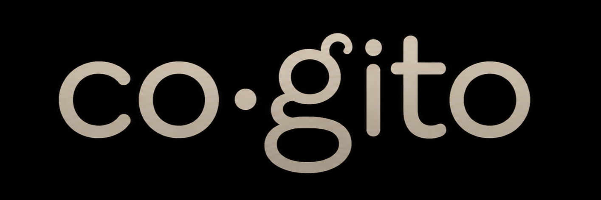

<p align="center">
  
</p>

<p align="center">
  <strong>One terminal. Every process. Pick up exactly where you left off.</strong>
</p>

**cogito** is a tmux-like terminal multiplexer for Linux, written in Go. It
turns one terminal into a color-rich workspace: shape it into panes, organize
work into windows, move with the keyboard or the mouse, and detach while your
shells keep running. Reattach and your layout is right where you left it.

Built for people who live in the shell, cogito keeps setup out of the way:
one binary, no configuration file to maintain, categorized help on demand,
and an interactive settings page when you want to tune the experience. It is
an early, deliberately small implementation focused on the essentials.

[Quick start](#quick-start) · [Why cogito](#why-cogito) ·
[Keyboard and mouse](#keyboard-and-mouse) · [Under the hood](#under-the-hood) ·
[Current scope](#current-scope)

## Why cogito?

| Benefit | What it means in your terminal |
| :--- | :--- |
| **A session that stays alive** | A detached server owns the PTYs and terminal state. `Ctrl-a` `d` disconnects; `cogito attach` brings every pane and window back. |
| **Layouts that follow your work** | Split panes left/right or top/bottom into a binary tree, resize by dragging a divider or with repeatable Ctrl-arrow keys, and land directly in every newly created pane or window. |
| **Windows with context built in** | A status bar highlights the active window with `*`, flags zoom with `Z`, and can name windows automatically after the foreground process. |
| **Navigation without a detour** | `Ctrl-a` `o` cycles panes, `Ctrl-a` `q` overlays large pane numbers for instant jumps, and `Ctrl-a` `Ctrl-a` sends a literal Ctrl-a to the application. |
| **Mouse-ready, keyboard-complete** | Click to focus, double-click to zoom, click a status-bar tab to switch windows, or drag a divider to resize. Every core action also has a keyboard path. |
| **Focus without losing the big picture** | Floating zoom lifts the active pane above the split layout, centered with at least a 2% margin. Toggle it again and the original layout returns. |
| **Terminal color that stays true** | Pane output preserves ANSI 16-color, 256-color, and 24-bit RGB styling, while active borders, window tabs, and help are color-coded for quick orientation. |
| **Guidance, tuning, and a safety net** | Categorized help, a scrollable settings page, and an optional y/n confirmation before shutdown keep powerful actions discoverable and deliberate. |
| **One view, multiple terminals** | Multiple clients can attach to the same session. Like tmux, the effective terminal size follows the smallest attached client. |

## Quick start

Requires **Linux** and **Go 1.24+**.

### Install and launch

```sh
go install github.com/demongiggle/cogito/cmd/cogito@latest
cogito
```

`go install` places the binary in `$(go env GOBIN)` (or
`$(go env GOPATH)/bin`), so make sure that directory is on your `PATH`. To
install a checkout instead, run `go install ./cmd/cogito`.

Prefer building locally?

```sh
git clone https://github.com/demongiggle/cogito.git
cd cogito
make            # builds ./cogito
./cogito
```

Without `make`, use `go build -o cogito ./cmd/cogito`. Run `make help` for
test, vet, install, and clean targets, and set `BINARY=/path/to/cogito` to
change the build output.

### Everyday commands

```sh
cogito              # start the session server if needed, then attach
cogito attach       # attach to the running session
cogito kill-server  # terminate the session and all panes
```

The `server` subcommand is internal; the CLI starts it automatically on the
first run.

### Your first minute

The command prefix is `Ctrl-a`: press and release it, then press the next key.

1. Split with `Ctrl-a` `|` or `Ctrl-a` `-`; the new pane takes focus.
2. Create another workspace with `Ctrl-a` `c`; switch with `Ctrl-a` `n` / `p`.
3. Press `Ctrl-a` `q`, then a pane number, to jump straight there.
4. Press `Ctrl-a` `z` (or double-click) to float and restore the active pane.
5. Press `Ctrl-a` `d`, close the terminal, then run `cogito attach`.

Your shells, windows, and layout are still there.

## Keyboard and mouse

| Keys | Action |
| :--- | :--- |
| `Ctrl-a` `\|` | Split left/right |
| `Ctrl-a` `-` | Split top/bottom |
| `Ctrl-a` `c` | New window |
| `Ctrl-a` `n` / `p` | Next / previous window |
| `Ctrl-a` `o` | Cycle to next pane |
| `Ctrl-a` `q` | Show pane numbers / jump to pane |
| `Ctrl-a` `s` | Open categorized settings |
| `Ctrl-a` `x` | Close current pane |
| `Ctrl-a` `&` | Shut down session (confirm) |
| `Ctrl-a` `z` | Toggle floating pane zoom |
| `Ctrl-a` `d` | Detach; the session keeps running |
| `Ctrl-a` `Ctrl-←/→/↑/↓` | Resize pane (repeatable) |
| `Ctrl-a` `Ctrl-a` | Send a literal `Ctrl-a` to the app |
| `Ctrl-a` `?` | Show categorized key help |

The split keys match the divider they draw: `|` separates left/right panes
and `-` separates top/bottom panes. New panes and windows take focus
immediately, so the next keystrokes go to the shell you just opened.

### Fast, precise pane movement

`Ctrl-a` `q` is tmux-style `display-panes`: a large, color-coded number
appears in every pane and the status bar hints at the range. Press a number to
focus that pane; `Esc`, `q`, `Ctrl-c`, or any other non-number key cancels.
The overlay belongs only to the attached client and clears after about two
seconds. Numbers start at zero and follow pane creation order.

With more than ten panes, a first digit that could begin a two-digit number
waits briefly: type the next digit, press Enter to accept the first digit, or
wait for automatic selection. Jumping to a hidden pane while zoomed restores
the split layout.

Ctrl-arrow resize keys are repeatable: after `Ctrl-a` `Ctrl-→`, keep Ctrl held
and press another arrow within half a second to resize again without another
prefix. A different Ctrl-arrow works in the same repeat window; any other
key, a new prefix, or the timeout ends it and returns Ctrl-arrow input to
the pane.

### Help and settings, right where you work

`Ctrl-a` `?` opens a categorized, color-coded cheatsheet for pane, window,
layout, session, and mouse commands. On short terminals, scroll with `↑` /
`↓`, `PgUp` / `PgDn`, or `j` / `k`; press `Esc`, `q`, or almost any other key
to close it. The menu is local to the attached client.

`Ctrl-a` `s` opens a categorized, scrollable settings page. Use `↑` / `↓`
(or `j` / `k`), `PgUp` / `PgDn`, `Home` / `End`, or `g` / `G` to move; press
`←` / `→` (or `h` / `l`), Enter, Space, or Tab to cycle a value. Press `q`,
`Esc`, `Ctrl-c`, `s`, or `Ctrl-a` `s` to close.

Tune the status clock, active border color, pane-number timeout, double-click
zoom, keyboard resize step, automatic window names, and shutdown confirmation.
Values are shared by all attached clients for the server's lifetime. They are
kept in memory, not written to a config file, and reset when the server exits.

### Mouse shortcuts

Click a pane to focus it; double-click a pane to float it above the split as a
centered zoom overlay, or double-click the floating pane to restore the
layout. Click a window name in the status bar to switch windows, and drag a
border between panes to resize live. The mouse wheel scrolls nothing because
scrollback is not implemented yet.

### Deliberate shutdown

Unless **Confirm shutdown** is off, the destructive `Ctrl-a` `&` chord opens a
modal confirmation before ending cogito's single session. Press `y` or Enter
to shut down every window and pane; `n`, `q`, `Esc`, or `Ctrl-c` cancels.
Other keys are swallowed while the dialog is open. The dialog is local to the
attached client; `cogito kill-server` shuts down immediately without a prompt.

When the shell in the last pane of the last window exits, the session ends and
attached clients exit with it. This shell-driven exit is not prompted.

## Under the hood

```text
cogito (client)  ──gob over unix socket──▶  cogito server (detached daemon)
   tcell UI                                  owns PTYs, vt10x terminals,
   input + mouse                             layout tree, compositor
```

- `cmd/cogito` — CLI: spawn/attach and `kill-server`
- `internal/client` — tcell front-end: draws frames, encodes keys and mouse
- `internal/server` — session daemon: pane/PTY management, layout, screen
  compositor, and prefix-key state machine
- `internal/layout` — binary split tree with rectangle math, hit-testing, and
  resize
- `internal/protocol` — gob-encoded messages over a Unix socket

The server renders the whole screen — panes, borders, and status bar — into a
cell grid, diffs it against the previous frame, and ships only changed cells
to clients. Clients stay thin: they draw cells and forward input.

The server socket lives in `$COGITO_SOCKET_DIR/default`,
`$XDG_RUNTIME_DIR/cogito-<uid>/default`, or
`/tmp/cogito-<uid>/default`. Server logs are written to `server.log` next to
the socket. Environment variables:

- `COGITO_SOCKET_DIR` — override the socket directory, useful for testing
- `COGITO_DEBUG_LOG` — append client-side input events to this file

## Development

```sh
make check         # format check, vet, build, and tests
go test ./...      # unit + integration tests
go vet ./...
go build -o cogito ./cmd/cogito
```

<details>
<summary>Manual smoke checklist</summary>

Automated coverage lives in `go test ./...`; integration tests drive a real
server over a Unix socket. The interactive path is best checked by hand or
under `script(1)`:

```sh
COGITO_SOCKET_DIR=$(mktemp -d) script -qec ./cogito /tmp/cogito.log
```

- [ ] `cogito` starts a session: shell appears, status bar shows `0:<name>*` plus clock
- [ ] `printf '\033[31mred\033[0m \033[48;5;22mgreen\033[0m\n'` shows colors in a pane
- [ ] active pane border, active window tab, and `Ctrl-a ?` help are color-coded
- [ ] `Ctrl-a |` splits left/right; `Ctrl-a -` splits top/bottom; the new pane takes focus
- [ ] `Ctrl-a o` cycles panes; focus follows
- [ ] `Ctrl-a q` numbers every pane; `0` / `1` jumps there and clears the overlay
- [ ] `Ctrl-a z` floats the active pane (centered, at least 2% margins, `Z` flag), toggle restores
- [ ] double-click a pane zooms it; double-click the floating pane restores the split
- [ ] click a pane to focus it; click a window name in the status bar to switch windows
- [ ] drag a border: the pane resizes live and stays after detach/reattach
- [ ] `Ctrl-a c` opens and focuses a window; `Ctrl-a n` / `p` switch; status bar updates
- [ ] type in a pane, `Ctrl-a d` detaches, `cogito attach` restores with the pane intact
- [ ] `Ctrl-a ?` opens the categorized help menu; `Esc` / `q` closes it; pane input resumes
- [ ] `Ctrl-a s` opens categorized settings; arrows scroll and `←` / `→` change a visible setting
- [ ] `Ctrl-a &` opens shutdown confirmation; `n` / `Esc` cancels; `y` ends the server
- [ ] `Ctrl-a Ctrl-Left/Right/Up/Down` resizes; holding Ctrl and repeating the arrow resizes without another prefix
- [ ] kill the pane (`Ctrl-a x`): window closes; killing the last pane quits everything
- [ ] `cogito kill-server` from another terminal shuts the session down
- [ ] two attached clients: the smaller terminal wins (min-size); closing it grows the other to full size
- [ ] tiny terminal (`<40x10`): shows "terminal too small" instead of garbage
- [ ] `COGITO_DEBUG_LOG=/tmp/cogito.debug ./cogito` logs key/mouse events for troubleshooting

Mouse events can be injected without a real mouse (SGR 1006): press at
(col,row) is `ESC [ < 0 ; COL ; ROW M`, release is `... m`, and motion with
the button held is `... 32 ; COL ; ROW M` (coordinates are 1-based).

</details>

## Current scope

cogito is early and intentionally focused. It currently offers **one unnamed
session** and:

- Runs on Linux only
- Has no scrollback or copy mode
- Has no persisted config file, plugins, or full theming; settings are
  session-only
- Has no window renaming or reordering

That focus is the point: a compact Go codebase, a single binary, and a
multiplexer you can understand at a glance.
