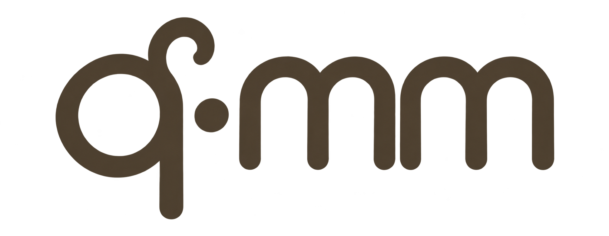

<p align="center">
  <picture>
    <source media="(prefers-color-scheme: dark)" srcset="assets/qmm-dark.png" />
    <source media="(prefers-color-scheme: light)" srcset="assets/qmm-light.png" />
    
  </picture>
</p>

<p align="center">
  <strong>One terminal. Every process. Pick up exactly where you left off.</strong>
</p>

<p align="center">
  <a href="https://github.com/demongiggle/qmm/actions/workflows/ci.yml"></a>
  <a href="https://github.com/demongiggle/qmm/releases/latest"></a>
  <a href="https://go.dev"></a>
</p>

**qmm** is a tmux-like terminal multiplexer for Linux, written in Go. It
turns one terminal into a color-rich workspace: shape it into panes, organize
work into windows, move with the keyboard or the mouse, and detach while your
shells keep running. Reattach and your layout is right where you left it.

Built for people who live in the shell, qmm keeps setup out of the way:
one binary, an automatically managed TOML config file, categorized help on
demand, and an interactive settings page when you want to tune the experience.
It is an early, deliberately small implementation focused on the essentials.

[Quick start](#quick-start) · [Why qmm](#why-qmm) ·
[Keyboard and mouse](#keyboard-and-mouse) ·
[Copy mode](#scrollback-and-vim-style-copy-mode) ·
[Under the hood](#under-the-hood) · [Current scope](#current-scope)

## Why qmm?

| Benefit | What it means in your terminal |
| :--- | :--- |
| **A session that stays alive** | A detached server owns the PTYs and terminal state. `Ctrl-a` `d` disconnects; `qmm attach` brings every pane and window back. |
| **Layouts that follow your work** | Split panes left/right or top/bottom into a binary tree, resize by dragging a divider or with repeatable Ctrl-arrow keys, and land directly in every newly created pane or window. |
| **Windows with context built in** | A status bar highlights the active window with `*`, flags zoom with `Z`, and can name windows automatically after the foreground process. |
| **Navigation without a detour** | `Ctrl-a` `o` cycles panes, `Ctrl-a` `q` overlays large pane numbers for instant jumps, and `Ctrl-a` `Ctrl-a` sends a literal Ctrl-a to the application. |
| **Mouse-ready, keyboard-complete** | Click to focus, double-click to zoom, click a status-bar tab to switch windows, or drag a divider to resize. Every core action also has a keyboard path. |
| **Focus without losing the big picture** | Floating zoom lifts the active pane above the split layout, centered with at least a 2% margin. Toggle it again and the original layout returns. |
| **History you can search and copy** | `Ctrl-a` `[` opens a vim-keyed copy mode over each pane's scrollback, or drag with the mouse to select directly; copy with `Ctrl-Shift-C` (configurable) or `y` to the host clipboard and qmm's paste buffer, then paste with `Ctrl-a` `]`. |
| **Terminal color that stays true** | Pane output preserves ANSI 16-color, 256-color, and 24-bit RGB styling, while active borders, window tabs, and help are color-coded for quick orientation. |
| **Guidance, tuning, and a safety net** | Categorized help, a scrollable settings page, and an optional y/n confirmation before shutdown keep powerful actions discoverable and deliberate. |
| **One view, multiple terminals** | Multiple clients can attach to the same session. Like tmux, the effective terminal size follows the smallest attached client. |

## Quick start

Requires **Linux** and **Go 1.24+**.

### Install and launch

```sh
go install github.com/demongiggle/qmm/cmd/qmm@latest
qmm
```

`go install` places the binary in `$(go env GOBIN)` (or
`$(go env GOPATH)/bin`), so make sure that directory is on your `PATH`. To
install a checkout instead, run `go install ./cmd/qmm`.

Prebuilt releases ship `qmm_<os>_<arch>.tar.gz` (plus `SHA256SUMS`).
For a manual install, download the tarball for your platform, verify it,
and put the extracted `qmm` on your `PATH` — the tar preserves the
executable bit:

```sh
curl -LO https://github.com/demongiggle/qmm/releases/download/v0.1.0/qmm_linux_amd64.tar.gz
curl -LO https://github.com/demongiggle/qmm/releases/download/v0.1.0/SHA256SUMS
sha256sum -c SHA256SUMS --ignore-missing
tar xzf qmm_linux_amd64.tar.gz
./qmm --version
```

Once on your `PATH`, it can keep itself current with `qmm update`; see
[Staying up to date](#staying-up-to-date).

Prefer building locally?

```sh
git clone https://github.com/demongiggle/qmm.git
cd qmm
make            # builds ./qmm
./qmm
```

Without `make`, use `go build -o qmm ./cmd/qmm`. Run `make help` for
test, vet, install, and clean targets, and set `BINARY=/path/to/qmm` to
change the build output.

### Everyday commands

```sh
qmm              # start the session server if needed, then attach
qmm attach       # attach to the running session
qmm kill-server  # terminate the session and all panes
qmm update       # install the latest release
qmm --version    # show the installed version
```

The `server` subcommand is internal; the CLI starts it automatically on the
first run.

### Staying up to date

```sh
qmm update               # install the latest stable release
qmm update --arch arm64   # pick a different architecture
qmm update --pre          # also consider release candidates
qmm update --help
```

`qmm update` reads the latest GitHub release, compares its tag with the
running binary's version, and downloads the `qmm_<os>_<arch>.tar.gz` asset
for this platform. It extracts the single `qmm` executable inside and
installs it beside the running binary with an atomic rename. The download URL must be an HTTPS
`github.com/demongiggle/qmm/releases/download/...` URL; the new binary is
written beside the executable and moved into place with an atomic rename. If
the installed version is already current or newer, nothing is downloaded.
Without `--pre` only stable releases are considered; with `--pre`, drafts are
ignored and the highest-versioned release with a matching asset wins.
`--arch` accepts `amd64`, `arm64`, `x86_64`, `aarch64`, or `os_arch` (the OS
must match the host). Release assets are built for Linux (`amd64`, `arm64`),
macOS (`amd64`, `arm64`), and FreeBSD (`amd64`); qmm is developed and tested
on Linux, and the other Unix builds are cross-compiled.

Release builds stamp their Git tag into the binary, so `qmm --version`
reports something like `qmm v0.2.0`. Untagged builds (including `go install`
builds) report `qmm dev` and always install the latest release, even if the
binary on disk is already current.

A detached qmm server keeps running the old binary after an update: existing
windows, panes, and shells are never interrupted. New clients and servers
start from the updated binary right away. When you want the running session
itself to use the new version, restart it with `qmm kill-server` followed by
`qmm` — this ends the current windows and panes, so save any work first.

### Your first minute

The command prefix is `Ctrl-a`: press and release it, then press the next key.

1. Split with `Ctrl-a` `|` or `Ctrl-a` `-`; the new pane takes focus.
2. Create another workspace with `Ctrl-a` `c`; switch with `Ctrl-a` `n` / `p`.
3. Press `Ctrl-a` `q`, then a pane number, to jump straight there.
4. Press `Ctrl-a` `z` (or double-click) to float and restore the active pane.
5. Press `Ctrl-a` `[`, move with `h/j/k/l`, then `v` and `y` to copy text.
6. Press `Ctrl-a` `d`, close the terminal, then run `qmm attach`.

Your shells, windows, and layout are still there.

## Keyboard and mouse

| Keys | Action |
| :--- | :--- |
| `Ctrl-a` `\|` | Split left/right |
| `Ctrl-a` `-` | Split top/bottom |
| `Ctrl-a` `c` | New window |
| `Ctrl-a` `n` / `p` | Next / previous window |
| `Ctrl-a` `o` | Cycle to next pane |
| `Ctrl-a` `q` | Show pane numbers / jump to pane |
| `Ctrl-a` `s` | Open categorized settings |
| `Ctrl-a` `x` | Close current pane |
| `Ctrl-a` `&` | Shut down session (confirm) |
| `Ctrl-a` `z` | Toggle floating pane zoom |
| `Ctrl-a` `[` | Enter scrollback / copy mode |
| `Ctrl-a` `]` | Paste the last copied text |
| `Ctrl-a` `d` | Detach; the session keeps running |
| `Ctrl-a` `Ctrl-←/→/↑/↓` | Resize pane (repeatable) |
| `Ctrl-a` `Ctrl-a` | Send a literal `Ctrl-a` to the app |
| `Ctrl-a` `?` | Show categorized key help |

The split keys match the divider they draw: `|` separates left/right panes
and `-` separates top/bottom panes. New panes and windows take focus
immediately, so the next keystrokes go to the shell you just opened.

### Fast, precise pane movement

`Ctrl-a` `q` is tmux-style `display-panes`: a large, color-coded number
appears in every pane and the status bar hints at the range. Press a number to
focus that pane; `Esc`, `q`, `Ctrl-c`, or any other non-number key cancels.
The overlay belongs only to the attached client and clears after about two
seconds. Numbers start at zero and follow pane creation order.

With more than ten panes, a first digit that could begin a two-digit number
waits briefly: type the next digit, press Enter to accept the first digit, or
wait for automatic selection. Jumping to a hidden pane while zoomed restores
the split layout.

Ctrl-arrow resize keys are repeatable: after `Ctrl-a` `Ctrl-→`, keep Ctrl held
and press another arrow within half a second to resize again without another
prefix. A different Ctrl-arrow works in the same repeat window; any other
key, a new prefix, or the timeout ends it and returns Ctrl-arrow input to
the pane.

### Help and settings, right where you work

`Ctrl-a` `?` opens a categorized, color-coded cheatsheet for pane, window,
layout, session, and mouse commands. On short terminals, scroll with `↑` /
`↓`, `PgUp` / `PgDn`, or `j` / `k`; press `Esc`, `q`, or almost any other key
to close it. The menu is local to the attached client.

`Ctrl-a` `s` opens a categorized, scrollable settings page. Use `↑` / `↓`
(or `j` / `k`), `PgUp` / `PgDn`, `Home` / `End`, or `g` / `G` to move; press
`←` / `→` (or `h` / `l`), Enter, Space, or Tab to cycle a value. Press `r` or
`Ctrl-r` to reload external config edits, or `q`, `Esc`, `Ctrl-c`, `s`, or
`Ctrl-a` `s` to close.

Tune ten values: the status clock, active border color, cursor shape
(`Block`, `Underline`, or `Bar`), cursor blink, pane-number timeout,
double-click zoom, keyboard resize step, automatic window names, shutdown
confirmation, and the copy-selection key. The default caret is a steady block; turn **Cursor blink** on for
the 500 ms blink cycle. **Cursor shape** uses the host terminal's native
DECSCUSR caret — steady block, underline, or bar — so the underlying pane text
stays visible. qmm toggles that caret's visibility for blinking, keeping its
rate independent of pane output and frame rate. Applications still control
cursor visibility; their own DECSCUSR style requests are ignored. Terminals
without DECSCUSR fall back to their default cursor shape.

Values are shared by all attached clients for the server's lifetime and are
saved immediately to `$XDG_CONFIG_HOME/qmm/config.toml` (or
`~/.config/qmm/config.toml`); `QMM_CONFIG` overrides the full file path.
The file is created with defaults on first server start and read on later
starts. Missing keys use defaults and unknown keys are ignored. A successful
`r` / `Ctrl-r` reload applies external edits to every client and closes the
settings page. If the file is broken, qmm backs it up as
`config.toml.<timestamp>.bak`, writes a fresh default, logs the reason and paths
in `server.log`, and shows a one-time warning dialog on the first attached
client.

### Scrollback and vim-style copy mode

`Ctrl-a` `[` opens copy mode, a full-screen view of the active pane's
scrollback (2,000 lines per pane) plus its current screen. Movement is
vim-style, and the overlay belongs only to the attached client that opened it —
other clients keep using the pane as usual. Dragging over text with the mouse
selects it directly, without leaving the live view first: qmm snapshots the
scrollback into a copy-mode view with the selection anchored where you pressed
the button. The status bar stays in place while a mouse selection is active.
Press the configured copy key (`Ctrl-Shift-C` by default; see
[settings](#help-and-settings-right-where-you-work)) to copy the selection and
return to the live pane; `y` or `Enter` work too. While the selection is
active, the mouse wheel scrolls the snapshot and extends the selection into
scrollback. The selection highlight stays visible until you copy or leave
copy mode (`Esc`).

| Key | Action |
| :--- | :--- |
| `h` / `j` / `k` / `l`, arrows | Move by character / line |
| `w` / `b` / `e` | Next word / previous word / word end |
| `0` / `^` / `$` | Line start / first non-blank / line end |
| `g` `g`, `G` | First line / last line (`15G` jumps to line 15) |
| `H` / `M` / `L` | Top / middle / bottom of the visible page |
| `Ctrl-u` / `Ctrl-d`, `Ctrl-b` / `Ctrl-f`, `PgUp` / `PgDn` | Half / full page |
| `/` / `?`, `n` / `N` | Search forward / backward, repeat / reverse |
| `v` / `V` / `Ctrl-v` | Character / line / rectangle selection |
| `Ctrl-Shift-C` (configurable) | Copy the selection and leave copy mode |
| `y`, Enter | Copy the selection and leave copy mode |
| `q`, `Esc`, `Ctrl-c` | Leave copy mode without copying |

The copy key is configured in the **Copy mode** settings section (or as
`copy_key` under `[copy]` in `config.toml`) and accepts `Ctrl-Shift-C`
(default), `Ctrl-Shift-X`, `Ctrl-Y`, or `Ctrl-Insert`. Note that many
terminals grab `Ctrl-Shift-C` for their own clipboard and never forward it;
pick another binding there if copies seem to do nothing. `y` and `Enter`
always work. The selection is a character-wise snapshot: text is captured
as of the moment the drag started, so output that scrolls in afterwards is
not part of the selection.

Motions accept a numeric prefix (`10j`, `3w`), and the view follows the
cursor. `y` with no active selection copies the current line. Copied text goes
to the host terminal's clipboard through an OSC 52 escape sequence (supported
by xterm, iTerm2, WezTerm, kitty, and others) and is also kept in qmm's paste
buffer, so `Ctrl-a` `]` types it into the active pane even on terminals that
ignore OSC 52. The paste buffer is shared by all attached clients (as in
tmux), so a later `y` replaces it for everyone. Clipboard payloads are capped
at 64 KiB.

Scrollback is line-oriented: ordinary shell output is captured as it scrolls
off the top, while alternate-screen applications (vim, less, top) are not
added to the history. The mouse wheel scrolls copy mode; wheel-up enters it
from a live pane and wheel-down at the bottom closes it.

### Mouse shortcuts

Click a pane to focus it; double-click a pane to float it above the split as a
centered zoom overlay, or double-click the floating pane to restore the
layout. Click a window name in the status bar to switch windows, and drag a
border between panes to resize live. Scrolling the wheel enters copy mode and
moves through the active pane's scrollback; see
[Scrollback and vim-style copy mode](#scrollback-and-vim-style-copy-mode).
If help, settings, or pane numbers are open, a wheel event dismisses that
overlay instead.

Drag across text in a pane to select it. The moment the pointer leaves the
cell it started in, qmm opens a copy-mode view of that pane's scrollback with
a character-wise selection anchored at the press point; the selection
highlight stays visible after you release the button. Scrolling the wheel
with a selection active extends it into (or back out of) the scrollback.
Pressing the configured copy key — `Ctrl-Shift-C` by default — copies the
selection to the host clipboard and qmm's paste buffer and returns to the
live pane, where `Ctrl-a` `]` pastes it. `Esc` cancels without copying.
Plain clicks (no drag) behave as before: click to focus, double-click to zoom.
While a selection is open the mouse is otherwise captured by the selection, so
window-switch clicks are ignored until you copy or cancel.

### Deliberate shutdown

Unless **Confirm shutdown** is off, the destructive `Ctrl-a` `&` chord opens a
modal confirmation before ending qmm's single session. Press `y` or Enter
to shut down every window and pane; `n`, `q`, `Esc`, or `Ctrl-c` cancels.
Other keys are swallowed while the dialog is open. The dialog is local to the
attached client; `qmm kill-server` shuts down immediately without a prompt.

When the shell in the last pane of the last window exits, the session ends and
attached clients exit with it. This shell-driven exit is not prompted.

## Under the hood

```text
qmm (client)  ──gob over unix socket──▶  qmm server (detached daemon)
   tcell UI                                  owns PTYs, vt10x terminals,
   input + mouse                             layout tree, compositor
```

- `cmd/qmm` — CLI: spawn/attach, `kill-server`, and `update`
- `internal/client` — tcell front-end: draws frames, encodes keys and mouse
- `internal/server` — session daemon: pane/PTY management, scrollback, layout,
  screen compositor, copy mode, and prefix-key state machine
- `internal/update` — GitHub release lookup, semver comparison, download, and
  atomic self-replacement
- `internal/layout` — binary split tree with rectangle math, hit-testing, and
  resize
- `internal/protocol` — gob-encoded messages over a Unix socket

The server renders the whole screen — panes, borders, and status bar — into a
cell grid, diffs it against the previous frame, and ships only changed cells
to clients. Clients stay thin: they draw cells and forward input.

The server socket lives in `$QMM_SOCKET_DIR/default`,
`$XDG_RUNTIME_DIR/qmm-<uid>/default`, or
`/tmp/qmm-<uid>/default`. Server logs are written to `server.log` next to
the socket. Settings live in `$XDG_CONFIG_HOME/qmm/config.toml` or
`~/.config/qmm/config.toml`; `QMM_CONFIG` replaces that path with a full
file path. Environment variables:

- `QMM_SOCKET_DIR` — override the socket directory, useful for testing
- `QMM_CONFIG` — override the full config file path, useful for testing
- `QMM_DEBUG_LOG` — append client-side input events to this file

## Development

```sh
make check         # format check, vet, build, and tests
make release       # build qmm_<os>_<arch> release assets in dist/
go test ./...      # unit + integration tests
go vet ./...
go build -o qmm ./cmd/qmm
```

`make build` stamps the current Git tag into `qmm --version` (or `dev` for
untagged commits); set `VERSION=vX.Y.Z` to override it. `make release`
cross-compiles the Linux, macOS, and FreeBSD binaries that `qmm update`
expects, using the same version value. Upload those `dist/qmm_*` files to the
GitHub release for that tag.

<details>
<summary>Manual smoke checklist</summary>

Automated coverage lives in `go test ./...`; integration tests drive a real
server over a Unix socket. The interactive path is best checked by hand or
under `script(1)`:

```sh
QMM_SOCKET_DIR=$(mktemp -d) script -qec ./qmm /tmp/qmm.log
```

- [ ] `qmm` starts a session: shell appears, status bar shows `0:<name>*` plus clock
- [ ] `printf '\033[31mred\033[0m \033[48;5;22mgreen\033[0m\n'` shows colors in a pane
- [ ] active pane border, active window tab, and `Ctrl-a ?` help are color-coded
- [ ] `Ctrl-a |` splits left/right; `Ctrl-a -` splits top/bottom; the new pane takes focus
- [ ] `Ctrl-a o` cycles panes; focus follows
- [ ] `Ctrl-a q` numbers every pane; `0` / `1` jumps there and clears the overlay
- [ ] `Ctrl-a z` floats the active pane (centered, at least 2% margins, `Z` flag), toggle restores
- [ ] double-click a pane zooms it; double-click the floating pane restores the split
- [ ] click a pane to focus it; click a window name in the status bar to switch windows
- [ ] drag a border: the pane resizes live and stays after detach/reattach
- [ ] `Ctrl-a c` opens and focuses a window; `Ctrl-a n` / `p` switch; status bar updates
- [ ] type in a pane, `Ctrl-a d` detaches, `qmm attach` restores with the pane intact
- [ ] `Ctrl-a ?` opens the categorized help menu; `Esc` / `q` closes it; pane input resumes
- [ ] `Ctrl-a [` shows scrollback after `seq 1 50`; `h/j/k/l`, `w/b`, `gg/G`, `Ctrl-u/Ctrl-d`, and `/search` move the cursor
- [ ] `v` / `V` / `Ctrl-v` highlight a selection; `y` copies it, `q` quits without copying
- [ ] after `y`, the host paste shortcut pastes the text in another app (OSC 52); `Ctrl-a ]` types it back into the pane
- [ ] wheel-up enters copy mode from a live pane; wheel-down at the bottom closes it
- [ ] copy mode on one attached client does not cover the other client's screen
- [ ] `Ctrl-a s` opens categorized settings; arrows scroll, `←` / `→` changes a value, and `r` / `Ctrl-r` reloads the config
- [ ] settings page shows **Cursor shape** and **Cursor blink**; Block / Underline / Bar and blink On / Off change the host terminal's native cursor
- [ ] settings changes survive a server restart; external TOML edits take effect after `r` / `Ctrl-r` and update all attached clients
- [ ] a broken config file produces a timestamped `.bak`, a fresh default, a first-client warning dialog, and a `server.log` entry
- [ ] `Ctrl-a &` opens shutdown confirmation; `n` / `Esc` cancels; `y` ends the server
- [ ] `Ctrl-a Ctrl-Left/Right/Up/Down` resizes; holding Ctrl and repeating the arrow resizes without another prefix
- [ ] kill the pane (`Ctrl-a x`): window closes; killing the last pane quits everything
- [ ] `qmm kill-server` from another terminal shuts the session down
- [ ] two attached clients: the smaller terminal wins (min-size); closing it grows the other to full size
- [ ] tiny terminal (`<40x10`): shows "terminal too small" instead of garbage
- [ ] `QMM_DEBUG_LOG=/tmp/qmm.debug ./qmm` logs key/mouse events for troubleshooting

Mouse events can be injected without a real mouse (SGR 1006): press at
(col,row) is `ESC [ < 0 ; COL ; ROW M`, release is `... m`, and motion with
the button held is `... 32 ; COL ; ROW M` (coordinates are 1-based).

</details>

## Current scope

qmm is early and intentionally focused. It currently offers **one unnamed
session** and:

- Runs on Linux only
- Has line-oriented scrollback; alternate-screen history is not captured
- Has a small persisted TOML config file, but no plugins or full theming
- Has no window renaming or reordering

That focus is the point: a compact Go codebase, a single binary, and a
multiplexer you can understand at a glance.
